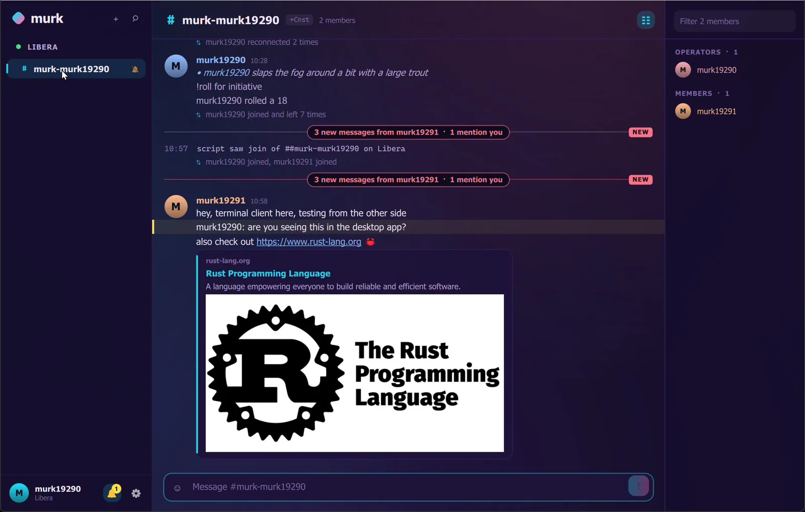

<div align="center">


# Murk

**An IRC client for the desktop and the terminal, built on one Rust core.**

[](LICENSE)
[](#requirements)

</div>

---

Murk has two front ends over the same engine: `murk-gui`, a Qt Quick desktop
app, and `murk`, a terminal client. Both share connections, logs, scripts,
themes and settings.



## What it does

- IRCv3: CAP 302, SASL PLAIN and EXTERNAL, server-time, message-tags, batch,
  echo-message, chathistory, labeled-response, away-notify, account-tag,
  extended-join, typing notifications, reactions (`+draft/react`) and replies
  (`+draft/reply`). Networks that deny client tags (CLIENTTAGDENY) get classic
  `nick:` replies, and reactions there stay local.
- TLS by default, reconnect with backoff, flood control that never delays PONG.
- A local SQLite log with full-text search, read markers and scrollback that
  pages in from the log, then from the server.
- Desktop client: grouped messages with avatars, day and unread dividers with a
  summary of what you missed, link preview cards (OpenGraph, images, YouTube),
  reactions and replies, emoji shortcodes and picker, folded join/part noise,
  a command palette, a channel browser, a mentions inbox, search, profile cards
  from WHOIS, spell check, DCC transfers with drag and drop, seven themes and a
  compact layout.
- Terminal client: buffers, nick list, completion, history, mIRC formatting,
  search, folded join/part runs, reactions and replies, the same themes.
- Lua 5.4 scripting, sandboxed: hooks, custom commands, timers.
- Passwords live in the system keyring (Windows Credential Manager, Secret
  Service on Linux), never in the config file.

## Requirements

- Windows 11, or Linux with Qt 6.8 or later for the desktop client.
- The terminal client needs only a terminal with 256 colors or true color.

## Building

```
# Rust stable and Qt 6.8
QMAKE=/path/to/Qt/6.8.3/<kit>/bin/qmake cargo build --release
```

This produces `target/release/murk-gui` and `target/release/murk`. Tagged
releases build a signed Windows installer and a Linux AppImage in CI.

## Using it

Start `murk-gui`, pick a network from the presets, and join channels from the
channel browser (Ctrl+J). Ctrl+K jumps anywhere; Ctrl+/ lists every shortcut.

The terminal client takes the same config:

```
murk [--config <path>] [--no-log] [network...]
```

`/help` lists commands in both clients. A few that are not standard IRC:

| Command | Does |
|---|---|
| `/react <emoji>` | React to the last message |
| `/reply <text>` | Reply to the last message |
| `/dcc send <nick> <path>` | Offer a file; `/dcc get` accepts an offer |
| `/theme <name>` | murk, aurora, ember, synthwave, mocha, phosphor, paper |
| `/script list`, `/script reload` | Manage Lua scripts |

## Configuration

The config file is TOML: `%APPDATA%\murk\murk.toml` on Windows,
`~/.config/murk/murk.toml` on Linux. It is written on first run and edited by
the desktop client's settings. Logs go to the platform data directory, or to
`MURK_DATA_DIR`.

## Scripting

Every `*.lua` file in the `scripts` folder next to the config loads at startup.
Scripts cannot touch files or run programs.

```lua
murk.command("slap", function(who)
  murk.me("slaps " .. who .. " around a bit with a large trout")
end, "/slap <nick>")

murk.on("message", function(m)
  if m.text:match("^!roll") then
    murk.say(m.nick .. " rolled a " .. math.random(1, 20))
  end
end)
```

Events: `message`, `input`, `join`, `part`, `connect`, `disconnect`.
Functions: `say`, `me`, `raw`, `print`, `react`, `run`, `timer`, `cancel`.
The first run writes a commented `example.lua.txt` into the folder.

## License

GPL-3.0-or-later. See [LICENSE](LICENSE).
